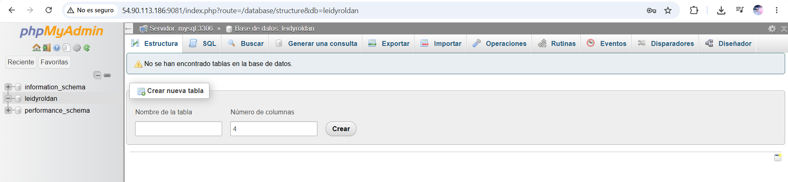
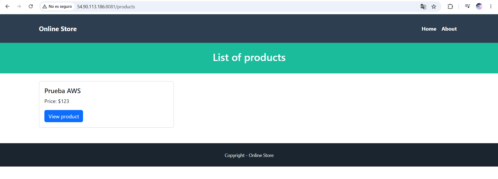
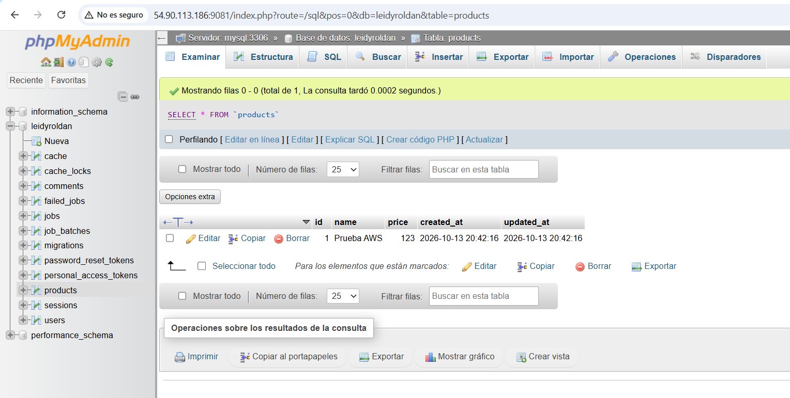
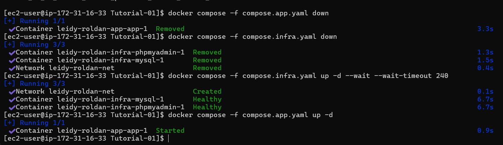
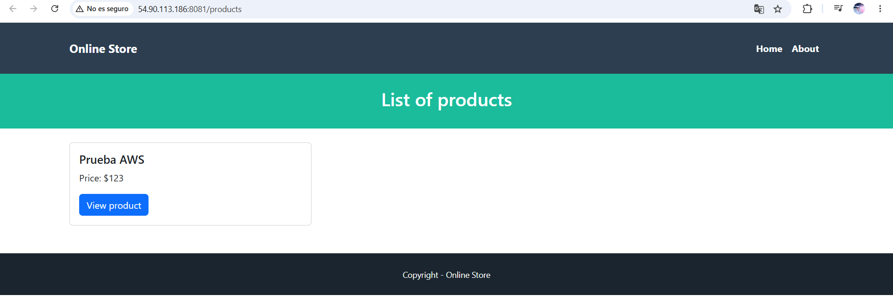
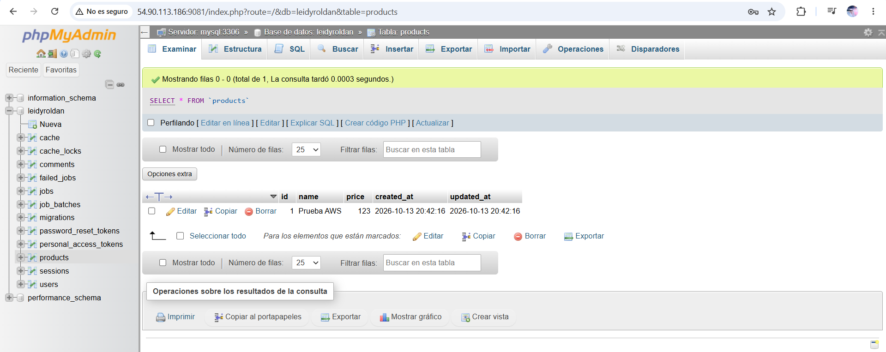
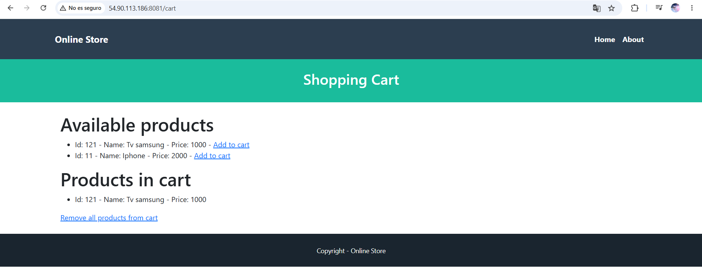
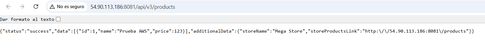
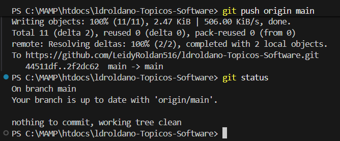
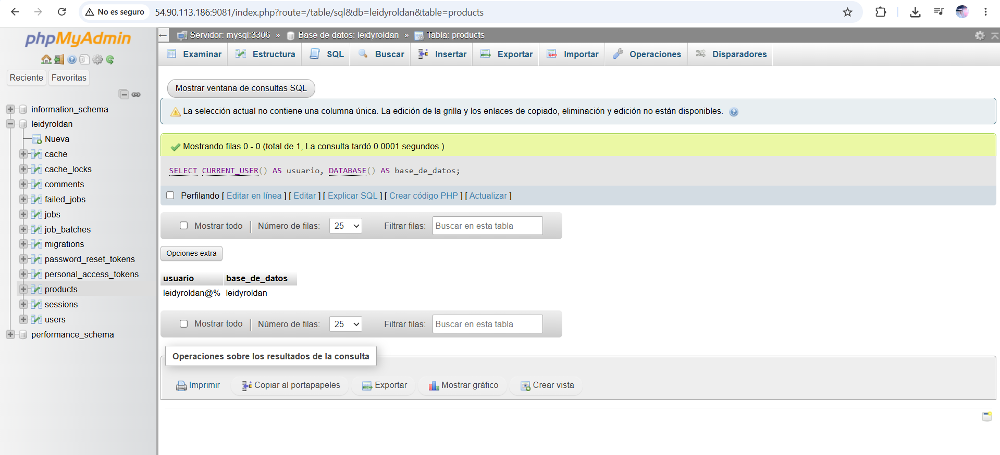

# Tutorial 05: Laravel, MySQL y phpMyAdmin con Docker

Leidy Roldan  

Entorno: instancia EC2 propia en AWS Academy, con Amazon Linux 2023.

La práctica se realizó con un despliegue individual de tres contenedores.

## Acceso

- Laravel: http://54.90.113.186:8081
- phpMyAdmin: http://54.90.113.186:9081
- Base de datos y usuario de Laravel: leidyroldan
- Red Docker: leidy-roldan-net

Los puertos públicos están restringidos a mi IP en el grupo de seguridad.
La instancia debe estar encendida para acceder. Si cambia su IP pública,
se deben actualizar las URL y APP_URL.

## Archivos

- Dockerfile: construye la imagen de Laravel con PHP 8.4 y Apache.
- .dockerignore: excluye credenciales y archivos innecesarios de la imagen.
- compose.infra.yaml: ejecuta MySQL y phpMyAdmin.
- compose.app.yaml: ejecuta Laravel conectado a la red de infraestructura.

El archivo .env y la clave SSH no se incluyen en GitHub.

## Verificación

- Se ejecutaron correctamente las seis migraciones.
- Se creó el producto “Prueba AWS”, con ID 1 y precio 123, desde Laravel.
- Se comprobó el registro en phpMyAdmin y en las API v1, v2 y v3.
- Se agregó el producto simulado 121 al carrito.
- Se ejecutó down y después up en ambos proyectos Compose, sin -v.
- El producto conservó su ID, nombre y precio después de recrear los contenedores.
- Se actualizó la imagen para corregir el enlace de productos de la API v3,
  conservando los datos y las credenciales.

## Preguntas

### 1. ¿Qué diferencia hay entre imagen, contenedor y volumen?

La imagen contiene la aplicación y sus dependencias. El contenedor es
una ejecución de esa imagen. El volumen guarda datos que pueden conservarse
aunque se elimine el contenedor.

### 2. ¿Por qué se repite el puerto interno 3306, pero cada puerto publicado debe ser distinto?

Cada contenedor tiene su propio entorno de red y puede usar internamente
3306. En una misma IP del servidor, los puertos publicados deben ser
distintos para evitar conflictos entre servicios.

### 3. ¿Por qué DB_HOST es mysql y no localhost?

mysql es el nombre del servicio que Docker resuelve dentro de la red.
localhost dentro de Laravel apunta a su propio contenedor, donde no
se ejecuta MySQL.

### 4. ¿Cómo conectan sus dos proyectos Compose?

El Compose de infraestructura crea leidy-roldan-net. El Compose de Laravel
usa esa misma red como externa, permitiendo la comunicación con MySQL.

### 5. ¿Qué diferencia hay entre GitHub y Docker Hub?

GitHub almacena el código y su historial de cambios. Docker Hub almacena
imágenes de contenedores listas para descargar y ejecutar.

### 6. ¿Por qué importa la arquitectura de una imagen?

La imagen debe ser compatible con la arquitectura del servidor,
por ejemplo amd64 o arm64. Una imagen incompatible puede requerir
emulación o no ejecutarse correctamente.

### 7. ¿Qué ocurre si elimina su volumen MySQL?

Se pierden los datos almacenados en ese volumen. Al iniciar MySQL con
un volumen nuevo, se inicializa una base nueva; recuperar los datos
anteriores requiere una copia de seguridad.

## Evidencias

### Base de datos creada

### Producto guardado desde Laravel

### Producto consultado en MySQL

### Recreación de contenedores sin eliminar volúmenes

### Producto conservado en Laravel

### Producto conservado en MySQL

### Carrito

### API v3

### Código subido a GitHub

### Usuario y base de datos

